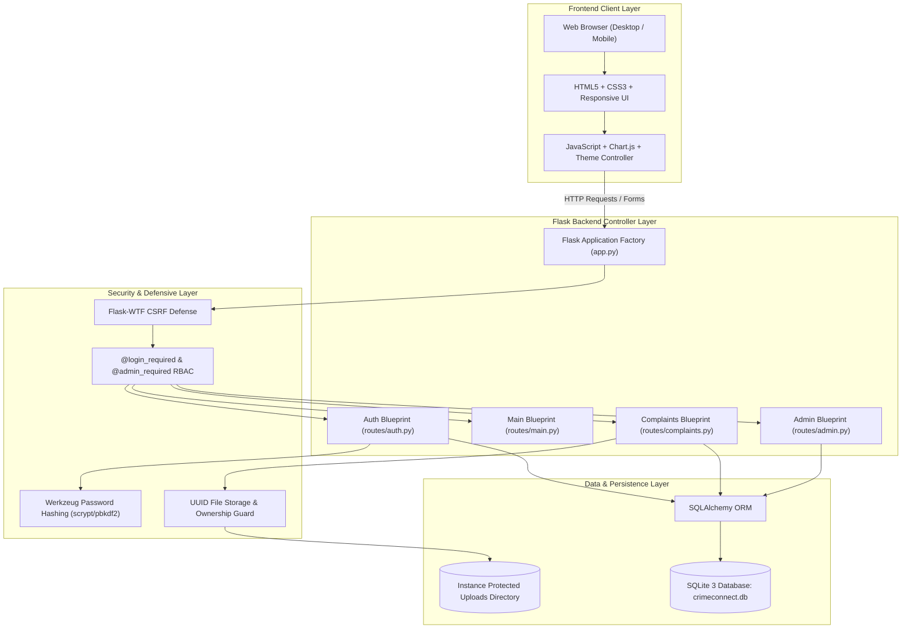
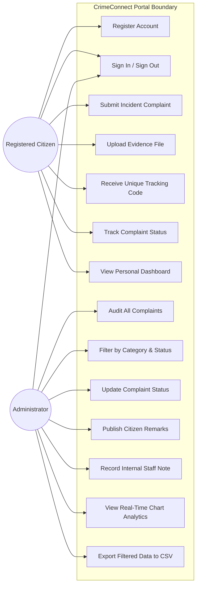
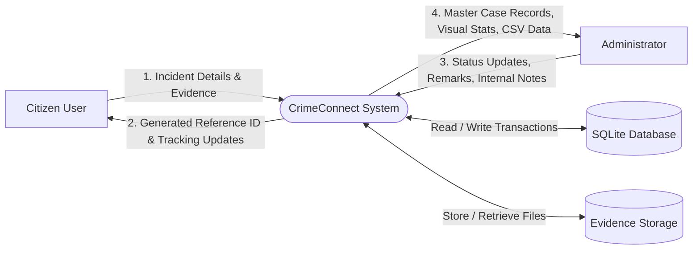
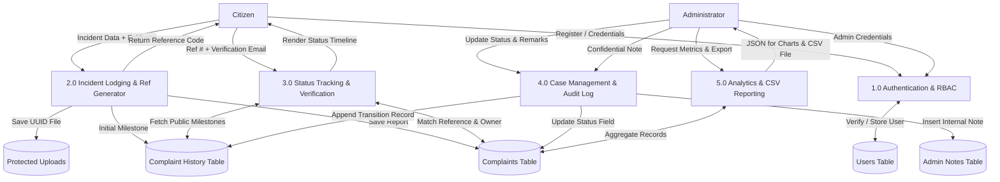
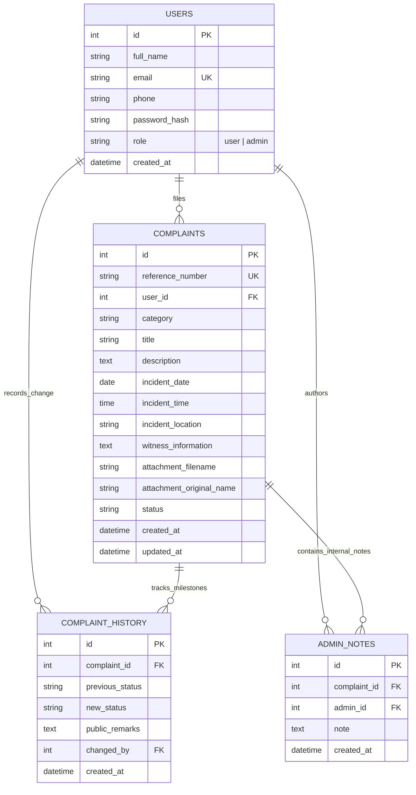

# COLLEGE ITL PROJECT REPORT
## CrimeConnect — Online Crime Reporting and Complaint Management System

**Course Title:** Information Technology Laboratory (ITL) / Web Engineering  
**Academic Year:** 2025–2026  
**Project Category:** Full-Stack Web Application  
**Technology Stack:** Python 3, Flask, SQLite 3, SQLAlchemy, HTML5, CSS3, JavaScript (ES6), Chart.js  

---

> [!NOTE]
> **Academic Declaration:**  
> This software system is developed as an educational prototype for demonstration within the Information Technology Lab curriculum. It does not represent an official government emergency reporting channel.

---

## 1. Project Abstract

The **Online Crime Reporting and Complaint Management System (CrimeConnect)** is a responsive, web-based software application engineered to modernize the lodging, tracking, and administrative review of simulated public complaints. Traditional paper-based complaint mechanisms are prone to administrative overhead, lack verifiable acknowledgment receipts, and leave complainants uninformed about the progress of their reports. 

CrimeConnect resolves these issues by offering an accessible digital portal where registered citizens can file detailed incident reports across standard categories (Theft, Cybercrime, Fraud, Harassment, Vandalism, Missing Property, and Other), upload supporting documentation safely, and receive an instant, cryptographically unique complaint reference identifier (`CR-YYYYMMDD-XXXXX`). Authorized administrators can audit incoming reports through a protected management console, transition complaints across defined lifecycle stages (*Submitted*, *Under Review*, *Additional Information Requested*, *Resolved*, *Closed*), publish transparent citizen-facing remarks, maintain confidential investigative notes, analyze real-time categorical incident charts, and export data to CSV. The platform adheres to defensive software engineering best practices including role-based access control (RBAC), password hashing, CSRF token validation, path-traversal prevention, and authorization-guarded tracking.

---

## 2. Introduction

Law enforcement and public safety systems depend fundamentally on accurate information capture and prompt communication. In traditional municipal complaint filing, citizens frequently experience physical delays, jurisdictional confusion, and a lack of transparency regarding whether their grievances are actively investigated. 

CrimeConnect demonstrates how modern lightweight web technologies—specifically Python and Flask combined with relational SQLite storage and modular client-side rendering—can establish an automated, transparent, and secure incident management workflow. Designed specifically for a college ITL practical, the application emphasizes clean architectural separation (MVC / Application Factory pattern), strong data integrity constraints, intuitive user experience, and defensive security measures.

---

## 3. Problem Statement

Conventional manual complaint lodging mechanisms suffer from several significant structural limitations:
1. **Absence of Immediate Verifiable Receipts:** Citizens submitting complaints physically often receive non-standardized paper acknowledgments that are easily lost or disputed.
2. **Opaque Investigation Status:** Complainants typically have no mechanism to track case progress without making repeated physical visits or phone inquiries.
3. **Data Redundancy and Loss:** Physical registries risk transcription errors, accidental damage, and lack automated backup or quick search retrieval.
4. **Administrative Bottlenecks:** Manual categorization makes compiling statistical reports, identifying regional incident clusters, and assigning personnel time-consuming.
5. **Privacy and Audit Concerns:** Paper files lack automated access controls, allowing unauthorized personnel to inspect sensitive grievance logs without an immutable audit trail.

---

## 4. Objectives

The primary objectives of CrimeConnect are:
1. **Automated Incident Filing:** Enable citizens to submit structured complaints online with categorized parameters, incident chronology, location, and optional evidence files.
2. **Instant Reference Code Generation:** Implement an algorithmic generator that creates unique, tamper-resistant reference numbers for every submission.
3. **Transparent Status Tracking:** Provide a status verification module allowing complainants to track case progress and administrative feedback in real time while preventing unauthorized public snooping.
4. **Role-Based Administrative Console:** Deliver a dedicated staff dashboard to review incident queues, manage statuses, append citizen remarks, and record internal investigative notes.
5. **Defensive Software Engineering:** Enforce security standards including salted password hashing, CSRF defense, parameterized ORM database queries, and secure file handling.
6. **Data Analytics & Portability:** Provide interactive visual distributions of incident categories and statuses using Chart.js, alongside CSV export capabilities for administrative auditing.

---

## 5. Scope

### In-Scope (Implemented Capabilities)
- Public information portal with guidance on incident categories, FAQs, and academic disclaimers.
- User authentication featuring client and server-side validation, salted password hashing, and role separation (*Citizen* vs. *Administrator*).
- Incident reporting form capturing category, title, date, approximate time, location, detailed description, witness info, and file attachments up to 5MB.
- Automatic reference number formatting: `CR-YYYYMMDD-XXXXX`.
- Dual-factor tracking verification requiring both Reference Number and Complainant Email.
- Complainant dashboard displaying personal filing history, status summary cards, and search filters.
- Protected administrator dashboard featuring status transition controls, public remarks, confidential staff notes, interactive Chart.js charts, and CSV report export.
- Automated unit and integration testing suite utilizing pytest.

### Out-of-Scope (Future Scope)
- Direct integration with national emergency telecommunication switches (911/112).
- Hardware GPS triangulation (the system utilizes user-entered location text).
- Payment gateways for fine assessments.

---

## 6. Existing System vs. Proposed System

| Parameter | Existing Traditional System | Proposed CrimeConnect System |
| :--- | :--- | :--- |
| **Submission Mode** | Physical visit to station with handwritten paperwork | 24/7 web-based responsive portal from desktop or mobile |
| **Acknowledgment** | Manual handwritten slip, prone to loss | Algorithmic, instantaneous unique reference ID |
| **Status Transparency** | Zero real-time updates; requires physical follow-up | Real-time audit timeline with administrative remarks |
| **Data Integrity** | Prone to ledger degradation, loss, or illegibility | ACID-compliant SQLite relational database with foreign keys |
| **Security & Privacy** | Physical registers accessible to any bystander | Role-Based Access Control, hashed passwords, isolated files |
| **Reporting & Analytics** | Manual tallying across logbooks | Real-time interactive Chart.js charts and instant CSV export |
| **Searchability** | Slow chronological manual searching | Instant search by reference ID, title, category, or location |

---

## 7. System Requirements

### 7.1 Hardware Requirements
- **Processor:** Intel Core i3 / AMD Ryzen 3 or equivalent (1.5 GHz or higher)
- **RAM:** 2 GB minimum (4 GB recommended)
- **Storage:** 200 MB free hard disk space for application files, virtual environment, and database
- **Display:** 1024x768 minimum resolution (responsive for tablet and smartphone viewports)

### 7.2 Software Requirements
- **Operating System:** Windows 10/11, Linux (Ubuntu 20.04+), or macOS
- **Programming Language:** Python 3.10 – 3.13
- **Web Framework:** Flask 3.x
- **ORM / Database:** Flask-SQLAlchemy / SQLite 3
- **Development Tool:** Visual Studio Code (VS Code)
- **Web Browser:** Modern browser (Google Chrome, Mozilla Firefox, Microsoft Edge, Safari)

---

## 8. System Architecture

CrimeConnect is constructed following the **Modular Application Factory Pattern** combined with **Model-View-Controller (MVC)** principles:



---

## 9. System Analysis & Design Diagrams

### 9.1 Use-Case Diagram



### 9.2 Data Flow Diagram (DFD Level 0 — Context Level)



### 9.3 Data Flow Diagram (DFD Level 1)



### 9.4 Entity-Relationship (ER) Diagram



---

## 10. Database Schema Dictionary

### Table 1: `users`
| Column | Data Type | Constraints | Description |
| :--- | :--- | :--- | :--- |
| `id` | INTEGER | PRIMARY KEY, AUTOINCREMENT | Unique user account identifier |
| `full_name` | VARCHAR(120) | NOT NULL | User's full legal name |
| `email` | VARCHAR(120) | UNIQUE, NOT NULL, INDEXED | Normalized login email address |
| `phone` | VARCHAR(20) | NULLABLE | Contact telephone number |
| `password_hash` | VARCHAR(255) | NOT NULL | Cryptographic password hash |
| `role` | VARCHAR(20) | NOT NULL, DEFAULT 'user' | Access role: `'user'` or `'admin'` |
| `created_at` | DATETIME | NOT NULL | Account creation UTC timestamp |

### Table 2: `complaints`
| Column | Data Type | Constraints | Description |
| :--- | :--- | :--- | :--- |
| `id` | INTEGER | PRIMARY KEY, AUTOINCREMENT | Internal complaint sequence identifier |
| `reference_number` | VARCHAR(32) | UNIQUE, NOT NULL, INDEXED | Public case reference (`CR-YYYYMMDD-XXXXX`) |
| `user_id` | INTEGER | FOREIGN KEY (`users.id`), NOT NULL | Complainant foreign key |
| `category` | VARCHAR(50) | NOT NULL | Category (e.g. Theft, Cybercrime, Fraud) |
| `title` | VARCHAR(150) | NOT NULL | Concise headline summary of incident |
| `description` | TEXT | NOT NULL | Chronological incident description |
| `incident_date` | DATE | NOT NULL | Calendar date of occurrence |
| `incident_time` | TIME | NULLABLE | Approximate time of occurrence |
| `incident_location` | VARCHAR(255) | NOT NULL | Location or digital venue of incident |
| `witness_information` | TEXT | NULLABLE | Eyewitness details, if available |
| `attachment_filename` | VARCHAR(255) | NULLABLE | UUID-renamed evidence file stored on disk |
| `attachment_original_name`| VARCHAR(255) | NULLABLE | Original client filename for download |
| `status` | VARCHAR(50) | NOT NULL, DEFAULT 'Submitted' | Current workflow lifecycle status |
| `created_at` | DATETIME | NOT NULL | Filing UTC timestamp |
| `updated_at` | DATETIME | NOT NULL | Last modification UTC timestamp |

### Table 3: `complaint_history`
| Column | Data Type | Constraints | Description |
| :--- | :--- | :--- | :--- |
| `id` | INTEGER | PRIMARY KEY, AUTOINCREMENT | Audit log sequence identifier |
| `complaint_id` | INTEGER | FOREIGN KEY (`complaints.id`), NOT NULL | Associated complaint foreign key |
| `previous_status` | VARCHAR(50) | NOT NULL | Status before state transition |
| `new_status` | VARCHAR(50) | NOT NULL | Status after state transition |
| `public_remarks` | TEXT | NULLABLE | Transparent remark visible to citizen |
| `changed_by` | INTEGER | FOREIGN KEY (`users.id`), NOT NULL | Admin or user ID who triggered transition |
| `created_at` | DATETIME | NOT NULL | Transition UTC timestamp |

### Table 4: `admin_notes`
| Column | Data Type | Constraints | Description |
| :--- | :--- | :--- | :--- |
| `id` | INTEGER | PRIMARY KEY, AUTOINCREMENT | Note record identifier |
| `complaint_id` | INTEGER | FOREIGN KEY (`complaints.id`), NOT NULL | Associated complaint foreign key |
| `admin_id` | INTEGER | FOREIGN KEY (`users.id`), NOT NULL | Authoring administrator foreign key |
| `note` | TEXT | NOT NULL | Confidential staff investigation note |
| `created_at` | DATETIME | NOT NULL | Note entry UTC timestamp |

---

## 11. Core Module Descriptions

1. **Authentication & Session Module (`routes/auth.py`):**  
   Handles user sign-up, session initiation, secure logouts, and profile introspection. Registration forms enforce email format validation, duplicate detection, and strictly assign the `'user'` role to prevent self-elevation. Passwords are saved as secure cryptographic hashes using Werkzeug.
2. **Main Navigation & Information Module (`routes/main.py`):**  
   Renders the public landing page with dynamic incident metrics retrieved directly from the database, along with architectural documentation and comprehensive FAQs.
3. **Complaint Submission & Filing Module (`routes/complaints.py`):**  
   Validates structured complaint fields, executes UUID-prefixed file uploads, generates unique reference codes via `Complaint.generate_reference_number()`, inserts initial audit records, and redirects to a confirmation receipt.
4. **Complaint Status Tracking Module (`routes/complaints.py`):**  
   Implements a two-factor verification query (Reference Number + Complainant Email) ensuring cases cannot be snooped merely by knowing reference numbers. Renders the public lifecycle milestone timeline and administrative remarks.
5. **Complainant Dashboard Module (`routes/complaints.py`):**  
   Provides authenticated citizens with personal case metrics (Total, Under Review, Resolved), search by keyword/location, status/category filtering, and links to detailed case files.
6. **Administrator Control Center Module (`routes/admin.py`):**  
   Restricted via the `@admin_required` decorator. Displays comprehensive system metrics, Chart.js visual charts, paginated complaint grids, full case triage, status modification forms, confidential internal notes, and one-click CSV export.

---

## 12. Algorithms and Workflow Logic

### Algorithm 1: Unique Reference Number Generation
```
Input: None
Output: Unique Reference Number string formatted as 'CR-YYYYMMDD-XXXXX'

1. date_string = Current UTC Date formatted as 'YYYYMMDD'
2. Loop indefinitely:
     a. random_token = Generate 3 cryptographically secure random bytes
     b. hex_suffix = Take first 5 characters of random_token in uppercase
     c. candidate_ref = Concatenate "CR-", date_string, "-", hex_suffix
     d. Query database for any complaint matching reference_number == candidate_ref
     e. If candidate_ref does NOT exist in database:
            Return candidate_ref
```

### Algorithm 2: Role-Based Authorization Guard (`@admin_required`)
```
Input: Route handler function f(*args, **kwargs)
Output: Decorated wrapper function

1. Check if current_user.is_authenticated is False:
       Redirect to login page with warning flash
2. Check if current_user.role != 'admin':
       Flash "Access denied. Administrator privileges required."
       Abort with HTTP 403 Forbidden
3. Execute and return f(*args, **kwargs)
```

---

## 13. Testing and Verification Results

The application includes an automated test suite executed with **pytest**. All 16 automated tests passed successfully with zero failures:

| Test ID | Test Name | Module | Tested Feature | Expected Outcome | Result |
| :--- | :--- | :--- | :--- | :--- | :--- |
| **TC-01** | `test_user_registration_success` | Auth | Citizen Registration | Account created, password hashed, role='user' | **PASS** |
| **TC-02** | `test_duplicate_email_registration_fails`| Auth | Duplicate Detection | Form validation error returned; no duplicate | **PASS** |
| **TC-03** | `test_password_confirmation_mismatch` | Auth | Password Matching | Error "Passwords must match" displayed | **PASS** |
| **TC-04** | `test_user_login_success` | Auth | Citizen Login | Session created, welcome message displayed | **PASS** |
| **TC-05** | `test_user_login_invalid_password` | Auth | Invalid Credentials | Authentication rejected with warning | **PASS** |
| **TC-06** | `test_user_logout` | Auth | Session Termination | Session cleared, redirected to index | **PASS** |
| **TC-07** | `test_complaint_submission_success` | Complaints | Complaint Filing | Reference `CR-` issued, initial history saved | **PASS** |
| **TC-08** | `test_complaint_submission_validation_errors`| Complaints | Form Validation | Short description rejected (<20 chars) | **PASS** |
| **TC-09** | `test_user_complaint_isolation` | Complaints | Complainant Privacy | User B requesting User A complaint gets 403 | **PASS** |
| **TC-10** | `test_complaint_tracking_authorization` | Complaints | Two-Factor Tracking | Valid ref + email works; wrong email rejected | **PASS** |
| **TC-11** | `test_complaint_file_upload_allowed_type`| Complaints | Secure File Upload | PDF accepted, renamed with UUID prefix | **PASS** |
| **TC-12** | `test_unauthorized_admin_access_rejected`| Admin | RBAC Defense | Citizen attempting `/admin` gets 403 | **PASS** |
| **TC-13** | `test_admin_dashboard_access_granted` | Admin | Admin Access | Administrator successfully views console | **PASS** |
| **TC-14** | `test_admin_status_update_and_audit_history`| Admin | Status Transition | Status changed, history audit entry created | **PASS** |
| **TC-15** | `test_admin_confidential_note_recording`| Admin | Staff Notes | Internal note saved, hidden from citizen | **PASS** |
| **TC-16** | `test_admin_csv_export` | Admin | Data Export | CSV streamed with proper headers & rows | **PASS** |

---

## 14. Limitations

1. **Simulated Environment:** Because this is an academic prototype, reports are not routed to real municipal emergency dispatch.
2. **Text-based Geolocation:** Location entry is captured as descriptive text rather than live GPS coordinate mapping.
3. **Synchronous File Storage:** File uploads are stored on the local filesystem rather than a cloud object bucket (e.g. AWS S3).
4. **Local Database:** The database uses SQLite, which is ideal for single-instance demonstrations and college labs, though high-concurrency production deployments would transition to PostgreSQL.

---

## 15. Future Enhancements

1. **Email / SMS Notifications:** Integration with SMTP or Twilio to dispatch automated tracking alerts when an administrator updates case status.
2. **Interactive Map Integration:** Leaflet.js or OpenStreetMap visualization to display incident density heatmaps.
3. **Multi-Admin Departmental Hierarchy:** Routing specific complaint categories (e.g., Cybercrime vs. Traffic) to dedicated specialized officers.
4. **Citizen Reply Channel:** Allowing complainants to reply directly to "Additional Information Requested" prompts with supplementary documentation.

---

## 16. Conclusion

The **CrimeConnect Online Crime Reporting System** successfully accomplishes all functional and architectural objectives defined for the Information Technology Lab curriculum. By leveraging Python, Flask, SQLite, and responsive front-end design, the system delivers an intuitive, secure, and transparent incident management portal. The implementation highlights key software engineering concepts: separation of concerns, defensive security programming, relational data modeling, automated testing, and human-centered user interface design.

---

## 17. References

1. Grinberg, Miguel. *Flask Web Development: Developing Web Applications with Python*. O'Reilly Media.
2. Pallets Projects. *Flask Documentation (3.0.x)*. https://flask.palletsprojects.com/
3. Bayer, Michael. *SQLAlchemy — The Database Toolkit for Python*. https://www.sqlalchemy.org/
4. OWASP Foundation. *OWASP Top 10 Web Application Security Risks*. https://owasp.org/www-project-top-ten/
5. Chart.js Documentation. *Open Source HTML5 Charts*. https://www.chartjs.org/
